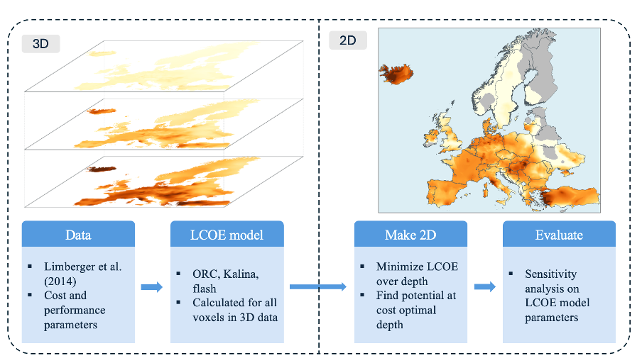
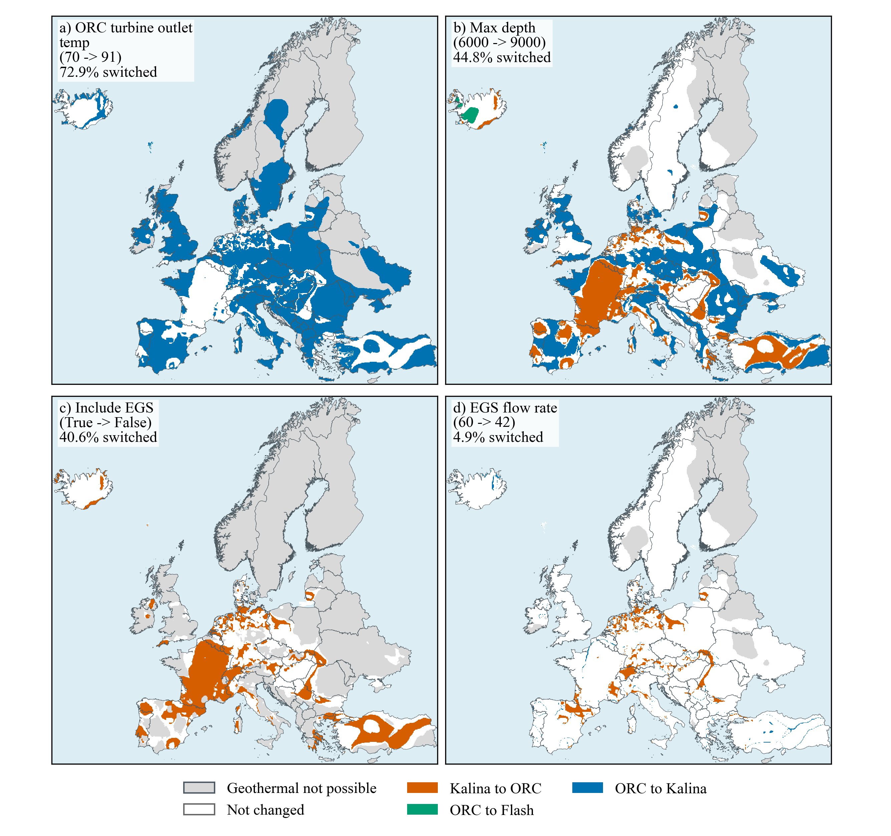

# Modelblocks - Geothermal module

This module calculates geothermal electricity production and levelized cost of
electricity (LCOE) from a European subsurface-temperature model based on
Limberger et al. (2014).


*Baseline LCOE for ORC, Flash, and Kalina cycles, with the least-cost technology
in each feasible grid cell. Grey areas are not feasible within the configured
maximum depth.*

## About

This is a modular `snakemake` workflow created as part of the
[Modelblocks project](https://www.modelblocks.org/). It can be imported directly
into any `snakemake` workflow.

For more information, consult the Modelblocks
[documentation](https://modelblocks.readthedocs.io/en/latest/), the
[integration example](./tests/integration/Snakefile), and the `snakemake`
[module documentation](https://snakemake.readthedocs.io/en/stable/snakefiles/modularization.html).

## How the module works



*Overview of the 3-D input data, voxel-level LCOE calculation, 2-D reduction,
and sensitivity evaluation used in the accompanying publication.*

The module works through the following stages:

1. **Prepare inputs.** Download the temperature voxel model and GST-1 sediment
   thickness data, align the sediment data to the temperature grid, and crop the
   model to the supplied study-area polygons.
2. **Build scenarios.** Write a scenario table containing the baseline and
   either explicitly configured scenarios or one-at-a-time sensitivity
   variations.
3. **Calculate geothermal performance.** For every scenario and selected power
   cycle, calculate depth-resolved energy potential and LCOE cubes. The model
   distinguishes conventional hydrothermal resources from Enhanced Geothermal
   Systems (EGS).
4. **Reduce the 3-D results to maps.** Either select the least-cost depth in each
   grid cell or retain separate configured depth bands. This stage produces the
   LCOE, potential, optimal-depth, and technology-comparison figures and rasters.
5. **Aggregate to regions.** Combine the gridded LCOE and potential results with
   the user-provided polygons using quantiles, fixed LCOE bins, or a single LCOE
   cutoff.
6. **Summarize sensitivity.** Compare each scenario with the baseline, calculate
   potential and technology-switch metrics, and produce overview plots when
   `perform_sensitivity` is enabled.

The sensitivity analysis shows where an input change alters the least-cost
conversion technology. In the example below, blue, orange, and green cells mark
technology transitions; white cells retain the baseline technology.



*Technology switches caused by the four sensitivity scenarios with the largest
spatial effect in the European example.*

## Rule graph

The graph below was generated from the Snakemake rule graph for the baseline and
sensitivity outputs. `make_2d_scenario` and the sensitivity summary rules are
only needed when additional scenarios are requested.


## Configuration

See the [configuration guide](./config/README.md) for all workflow controls,
model parameters, aggregation choices, and sensitivity settings. A complete
worked configuration is available in [`config/config.yaml`](./config/config.yaml).

## Input and output structure

The required polygon input and the module's public result path variables are
documented in [`INTERFACE.yaml`](./INTERFACE.yaml).

## Using this module

Import the module into another Snakemake workflow and map its path variables to
the parent workflow:

```python
module module_geothermal:
    snakefile: github("modelblocks-org/module_geothermal", path="workflow/Snakefile", branch="main")
    config: config["module_geothermal"]
    pathvars:
        logs="modules/geothermal/logs",
        resources="modules/geothermal/resources",
        results="modules/geothermal/results",
        shapes="modules/geo_boundaries/{shapes}/results/shapes.parquet"

use rule * from module_geothermal as module_geothermal_*
```

Module users can also provide named scenarios explicitly instead of using the
built-in parameter sweep:

```yaml
module_geothermal:
  perform_sensitivity: true
  scenarios:
    base: {}
    high_lifetime:
      lifetime: 40.0
```

## Development

We use [`pixi`](https://pixi.sh/) as our package manager for development. Once
installed, run the following to clone this repository and install all
dependencies:

```shell
git clone git@github.com:modelblocks-org/module_geothermal.git
cd module_geothermal
pixi install --all
```

For testing, run:

```shell
pixi run test-integration
```

To test a minimal example of a workflow using this module:

```shell
pixi shell
cd tests/integration/
snakemake --use-conda --cores 2
```
