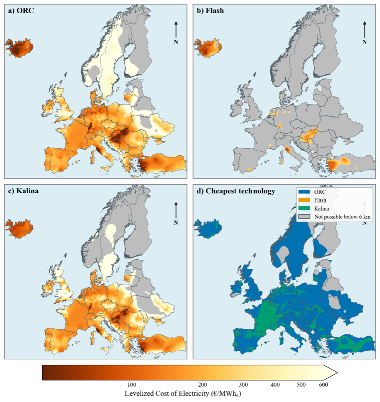
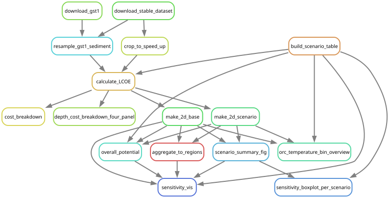

# Modelblocks - Geothermal module

This module calculates geothermal electricity and district-heating potential,
with levelized costs of electricity (LCOE) and heat (LCOH), from a European subsurface-temperature model based on
Limberger et al. (2014).



*LCOE for ORC, Flash, and Kalina cycles, with the least-cost technology
in each feasible grid cell. Grey areas are not feasible within the configured
maximum depth.*

## About

This is a modular `snakemake` workflow created as part of the
[Modelblocks project](https://www.modelblocks.org/). It can be imported directly
into any `snakemake` workflow.

For more information, consult the Modelblocks
[documentation](https://modelblocks.readthedocs.io/en/latest/), the
[integration example](./tests/integration/Snakefile), and the `snakemake`
[module documentation](https://snakemake.readthedocs.io/en/stable/snakefiles/modularization.html).

## How the module works

The module works through the following stages:

1. **Prepare inputs.** Download the temperature voxel model and GST-1 sediment
   thickness data, align the sediment data to the temperature grid, and crop the
   model to the supplied study-area polygons.
2. **Calculate geothermal performance.** Use the configured parameters for each
   selected power cycle to calculate depth-resolved energy potential and LCOE cubes. The model
   distinguishes conventional hydrothermal resources from Enhanced Geothermal
   Systems (EGS).
3. **Reduce the 3-D results to maps.** Either select the least-cost depth in each
   grid cell or retain separate configured depth bands. This stage produces the
   LCOE, potential, optimal-depth, and technology-comparison figures and rasters.
4. **Aggregate to regions.** Combine the gridded LCOE and potential results with
   the user-provided polygons using quantiles, fixed LCOE bins, or a single LCOE
   cutoff.
5. **Summarize potential.** Report study-wide potential by technology and for
   the portfolio selecting the lowest-LCOE technology in each cell.

With `carrier_out: heat`, the workflow instead interpolates the shallowest depth
reaching the configured district-heating temperature, calculates heat costs once
per cell, and allocates heat jointly to nearby networks. `heat_and_power` runs
both branches and reports competing resource uses. See the
[heat configuration and allocation guide](./config/README.md#district-heating)
for formulas, assumptions, and output units.

## Rule graph

The graph below includes regional results, model diagnostics, and the
study-wide potential summary for one configured run.



## Configuration

See the [configuration guide](./config/README.md) for all workflow controls,
model parameters and aggregation choices. A complete
worked configuration is available in [`config/config.yaml`](./config/config.yaml).

## Input and output structure

The required polygon input and the module's public result path variables are
documented in [`INTERFACE.yaml`](./INTERFACE.yaml). The input must be a
GeoParquet file with a declared coordinate reference system, unique `shape_id`
values, and valid Polygon or MultiPolygon geometry. An optional `shape_class`
column may be included; rows whose value is `maritime` are excluded from
regional aggregation.

The regional `geothermal_regions.parquet` output distinguishes `category` and
`carrier` as well as region, technology, depth category, and price bin.
Power `potential` is net electric capacity in MW; heat `potential` is allocated
annual heat in MWh/year. Always interpret it together with `potential_unit`.
`mean_lcoe` and `mean_lcoh` are weighted costs in €2020/MWh of the respective carrier.
See the [configuration guide](./config/README.md#inputs-and-outputs)
for the complete column contract and the study-wide TSV outputs.

## Using this module

Import the module into another Snakemake workflow and map its path variables to
the parent workflow:

```python
module module_geothermal:
    snakefile: github("modelblocks-org/module_geothermal", path="workflow/Snakefile", branch="main")
    config: config["module_geothermal"]
    pathvars:
        logs="modules/geothermal/logs",
        resources="modules/geothermal/resources",
        results="modules/geothermal/results",
        shapes="modules/geo_boundaries/{shapes}/results/shapes.parquet"

use rule * from module_geothermal as module_geothermal_*
```

Request `<results>/{shapes}/geothermal_regions.parquet` for regional results
and `<results>/{shapes}/overall_potential_summary.tsv` for study-wide totals.
For heat modes, provide `<resources>/user/{shapes}/areas.parquet` (or override
the `district_heating` path variable), set `carrier_out: heat` or
`heat_and_power`, and request the same regional target. Network results and
the allocation ledger are also produced and have public path variables.
The study-wide TSV and electrical diagnostic figures describe unconstrained
electricity resources; they are available in modes evaluating power. The
regional power overview shows capacity remaining after heat reservation.
Each invocation uses one parameter set from config for all selected cycles.
To run different parameter sets, import the module separately with distinct
resource and result directories.

## Figures and HTML report

Reports use the same command pattern as `module_euro_building_heat`: run the
normal result targets, then repeat that command with `--report`. From this
repository's root, for example:

```shell
pixi run snakemake --use-conda --cores 4 \
  results/euro_all/geothermal_regions.parquet
pixi run snakemake --use-conda --cores 4 \
  results/euro_all/geothermal_regions.parquet --report results/euro_all/report.html
```

The regional-results target also builds all applicable figures and the study-wide
potential summary. The second command embeds those outputs,
with captions and workflow metadata, into `results/euro_all/report.html`.
Snakemake's `--report` renders existing results; it does not run missing jobs.
Append `--dry-run` to the first command to preview the required work.

The workflow selects figures from the current configuration: LCOE and
cumulative-potential plots require `LCOE_minimization`; the regional map also
requires `cutoff` aggregation. Depth/cost diagnostics and the summary are always
included in power and combined modes. This electricity figure bundle is not
available in heat-only mode.

For a parent workflow importing this module, request `<geothermal_regions>` in
its target inputs as usual. After running it, use `snakemake --report report.html`
from that workflow's directory. No additional report target is needed.
The optional `<report_inputs>` target is retained for compatibility with existing
commands. Reports for other targets include the annotated outputs in their
dependency graph.

## Development

We use [`pixi`](https://pixi.sh/) as our package manager for development. Once
installed, run the following to clone this repository and install all
dependencies:

```shell
git clone git@github.com:modelblocks-org/module_geothermal.git
cd module_geothermal
pixi install --all
```

Pixi separates the development environment from the minimal `module`
environment used by Snakemake rules. After changing runtime dependencies,
regenerate the Conda environment and platform pins with:

```shell
pixi run export-snakemake-env module
```

Run the quick checks used during development with:

```shell
pixi run test-quick
```

Run isolated workflow checks (without downloads) and small numerical checks with:

```shell
pixi run pytest tests/test_workflow_config.py
pixi run -e module python -m unittest discover -s tests -p test_model_outputs.py
```

The integration definition is retained for dedicated workflow testing, but is
not part of the quick check. To run it explicitly:

```shell
pixi shell
cd tests/integration/
snakemake --use-conda --cores 2
```

## References

- [3D subsurface temperature model of Europe](https://doi.org/10.5281/zenodo.22149195), Zenodo dataset, version 1, CC BY 4.0.
- Limberger et al. (2014), [Assessing the prospective resource base for enhanced geothermal systems in Europe](https://doi.org/10.5194/gtes-2-55-2014), *Geothermal Energy Science* 2, 55–71.
- [Global Sediment Thickness Dataset v1 (GST-1)](https://doi.org/10.5281/zenodo.15320474), Zenodo dataset, CC BY 4.0.

Land-use exclusions can optionally constrain both heat and power using a supplied
area-potential raster. The workflow resamples it once onto the subsurface grid.
See the [eligibility configuration](config/README.md#land-eligibility).
