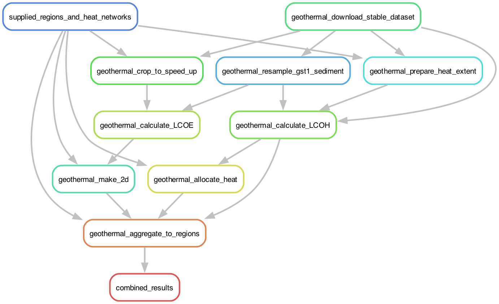

# Modelblocks - Geothermal module

This module calculates geothermal electricity and district-heating potential,
with levelized costs of electricity (LCOE) and heat (LCOH), from a European subsurface-temperature model based on
Limberger et al. (2014).


*LCOE for ORC, Flash, and Kalina cycles, with the least-cost technology
in each feasible grid cell. Grey areas are not feasible within the configured
maximum depth.*

## About

This is a modular `snakemake` workflow created as part of the
[Modelblocks project](https://www.modelblocks.org/). It can be imported directly
into any `snakemake` workflow.

For more information, consult the Modelblocks
[documentation](https://modelblocks.readthedocs.io/en/latest/), the
[integration example](./tests/integration/Snakefile), and the `snakemake`
[module documentation](https://snakemake.readthedocs.io/en/stable/snakefiles/modularization.html).

## How the module works

The module supports three operating modes: `power`, `heat`, and
`heat_and_power`. Each uses the same subsurface inputs to assess a different
use of geothermal resources.

All modes begin by downloading the temperature voxel model and GST-1 sediment
thickness data, aligning the sediment data to the temperature grid, and cropping
the model to the supplied study-area polygons.

- **Power (`power`).** Calculate depth-resolved electricity potential and LCOE
  for each selected power cycle, then select the least-cost depth in each grid
  cell for each technology. Aggregate the gridded results to the supplied
  regions using quantiles, fixed LCOE bins, or a single LCOE cutoff.
- **Heat (`heat`).** Interpolate the shallowest depth reaching the configured
  district-heating temperature and calculate heat costs once per grid cell.
  Allocate heat jointly to nearby networks, then report supplied annual heat
  and LCOH by consuming region.
- **Heat and power (`heat_and_power`).** Run both calculations to assess
  electricity generation and district heating together. Report their regional
  potentials and costs, identifying contested resources where the two uses
  compete so they can be interpreted as alternatives.

The workflow produces maps and regional results for the selected mode. See the
[module interface](./INTERFACE.yaml) for input requirements and output units,
and the [configuration schema](./workflow/internal/config.schema.yaml) for model
parameters and assumptions.

## Rule graph

The graph below shows `heat_and_power` mode, with the power and heat branches
feeding into regional aggregation. The supplied-input node represents the
user-provided regions and district-heating networks. Optional land eligibility
is disabled in this example.



## Configuration

See the [configuration schema](./workflow/internal/config.schema.yaml) for workflow
controls, model parameters, and aggregation choices, and the
[module interface](./INTERFACE.yaml) for model assumptions. A complete
worked configuration is available in [`config/config.yaml`](./config/config.yaml).

All monetary inputs in euros and all cost results use **constant 2020 euros
(EUR2020)**

## Input and output structure

Please consult the [module interface](./INTERFACE.yaml) for more information.


## Development

We use [`pixi`](https://pixi.sh/) as our package manager for development. Once
installed, run the following to clone this repository and install all
dependencies:

```shell
git clone git@github.com:Yegberink/module_geothermal.git
cd module_geothermal
pixi install --all
```

This is a multi-environment project (see [`pixi.toml`](./pixi.toml)):

- `default`: development and integration testing, including Snakemake, Conda,
  and pytest. Do not use this environment in Snakemake rules.
- `module`: runtime dependencies used by Snakemake rules. After changing these
  dependencies, export the environment YAML and platform pin files:

```shell
pixi run export-snakemake-env module
```

## Testing

Run the standard integration suite, including interface validation, environment
export checks, required-file checks, and a minimal imported workflow:

```shell
pixi run test-integration
```

To run the integration workflow directly:

```shell
pixi shell
cd tests/integration/
snakemake --use-conda --cores 2
```

For optional full workflow tests over three shape sets, including HTML reports
and PNG rule graphs, run:

```shell
pixi run pytest tests/local_test.py
```

These longer tests use the power integration configuration, disable eligibility,
and download their shape inputs. Heat networks and eligibility rasters are not
bundled test inputs. Graph rendering requires Graphviz's `dot` executable.
The CI integration task does not run these optional tests.

Run both workflow lint checks with:

```shell
pixi run snakemake --lint --snakefile workflow/Snakefile
pixi run snakemake --lint --snakefile tests/integration/Snakefile
```

## References

- [3D subsurface temperature model of Europe](https://doi.org/10.5281/zenodo.22149195), Zenodo dataset, version 1, CC BY 4.0.
- Limberger et al. (2014), [Assessing the prospective resource base for enhanced geothermal systems in Europe](https://doi.org/10.5194/gtes-2-55-2014), *Geothermal Energy Science* 2, 55–71.
- [Global Sediment Thickness Dataset v1 (GST-1)](https://doi.org/10.5281/zenodo.15320474), Zenodo dataset, CC BY 4.0.
